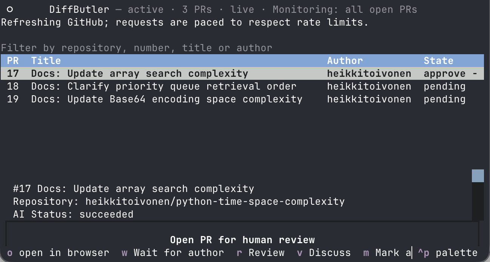

# DiffButler

A terminal dashboard for human-directed AI code reviews on GitHub.

Keep track of what each pull request needs next: AI review, your review, or author
changes. Start an AI review, discuss its findings in the agent's own session, and
finish your review in the browser.



## Install

Install [uv](https://docs.astral.sh/uv/getting-started/installation/) and Git.
From a local checkout of this repository, run:

```sh
uv tool install --python 3.14 .
```

uv manages Python and dependencies in an isolated environment. No virtual environment
activation is needed. If `diffbutler` is not on your PATH, run `uv tool update-shell`
and restart your shell.

Install and sign in to Codex CLI or Claude Code before requesting AI reviews.
The native presets support Codex CLI or Claude Code on Linux and macOS without version checks.
Reviews use your normal agent settings, including model and reasoning effort, with
background permission and output overrides. New conversations remain in the agent’s
own history after DiffButler cleans up its workspaces; existing private sessions
retain their original home for resume.
See [supported agents and validation](docs/native-reviews.md) for details.

## Use

Use authenticated GitHub access, including for public repositories. If you already
use `gh auth login`, export its token before launching DiffButler:

```sh
export GITHUB_TOKEN="$(gh auth token)"
```

Alternatively, create a [fine-grained personal access token](https://github.com/settings/personal-access-tokens)
for the repositories you want to review with **Pull requests: Read-only** permission,
and set it as `GITHUB_TOKEN`. Anonymous access is a last resort for public repositories;
its low API quota makes it unsuitable for regular polling. See the
[authentication guide](docs/github.md#authentication-options) for host/account selection,
HTTPS versus SSH Git setup, and token permissions.

From the GitHub repository you want to review, launch:

```sh
diffbutler
```

First-run setup detects the local repository, looks up your GitHub username using
the selected token, asks for your preferred agent, and saves your choices. If username detection
is unavailable, setup asks for it. Choose the recommended token access for public repositories;
private repositories require it. Setup asks for the token's environment variable name
and validates access. It never saves the token.
Later launches reuse your configuration.

The dashboard shows active reviews, including followed PRs whose GitHub review
requests have disappeared after you posted feedback. Waiting-for-author reviews
stay visible across refreshes and restarts. If an approved PR receives new commits,
it reappears as `done+` at the end of the queue without starting another AI review.

Select a PR with the arrow keys, then work through the review:

1. Press `r` to start a background AI review. Reviews start only when you request them.
   The agent is instructed to read the PR description, discussion, and earlier review
   threads and replies before reviewing the local code, reporting any unavailable context.
   DiffButler caches full Git history and reviews changes from the PR merge base
   to its head, excluding unrelated changes made later on the target branch.
2. A successful review shows `approve` only when the AI explicitly reports no findings;
   otherwise it shows `check`. Press `Enter` to read the results, or `v` to resume
   the saved agent conversation.
   Ask questions and explicitly tell the agent which comments to post, if any.
3. Exit the agent to return to the dashboard, which refreshes activity from GitHub.
   Press `w` if you are waiting for author changes, or `o` to review in your browser.
4. After approving on GitHub, press `m` to mark the task complete locally. DiffButler
   also detects your approval, closure, or merge and cleans up owned session resources
   while retaining review history.

`Space` performs the selected PR's next action: start a review, discuss findings,
or open the browser. An AI review never counts as your approval. Background analysis
uses the agent's native read-only controls; source sent to the agent may go to its
model provider.

- `/`: Filter the queue.
- `a`: Toggle monitoring all open PRs in configured repositories.
- `b`: Browse accessible PRs and follow one.
- `R`: Refresh from GitHub.
- `h`: View completed review history.
- `?`: Show all keyboard shortcuts.
- `q`: Quit.

See the [dashboard guide](docs/dashboard.md) for all actions and
[configuration guide](docs/configuration.md) for settings.

Your own PRs are hidden from the review queue by default, including direct and team
requests. Set `include_own_prs = true` in `[ui]` to review them, such as PRs an agent
created using your account. PRs assigned to you are also hidden by default, even when
you are requested directly or through a team. Set `include_assigned_prs = true` in
`[ui]` to include them.

## Reset

Close running DiffButler sessions, then run:

```sh
diffbutler reset
```

DiffButler refuses a second command or dashboard using the same data home, including
`reset`, while another instance is running. Its instance lock releases on process
exit; a leftover PID file does not block startup. See the
[locking details](docs/configuration.md#single-instance) before handling Git lock files
or resetting after a crash.

After confirmation, this permanently removes DiffButler's standard configuration,
data, and state directories, including review history, saved sessions, and diagnostic
logs. Custom files outside those directories are preserved. Use `diffbutler reset --force`
to skip confirmation. Run `diffbutler` again to repeat first-run setup.

## Contributing

See [CONTRIBUTING.md](CONTRIBUTING.md) for development setup and checks.

## License

[MIT](LICENSE.txt).
